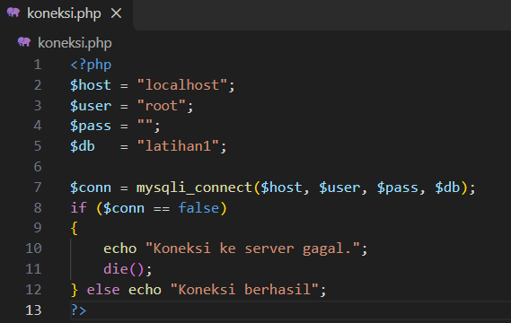
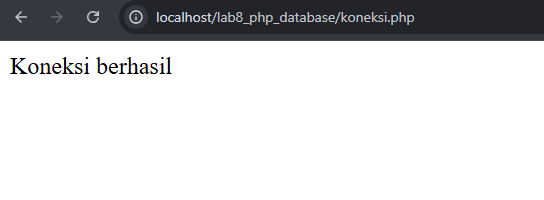
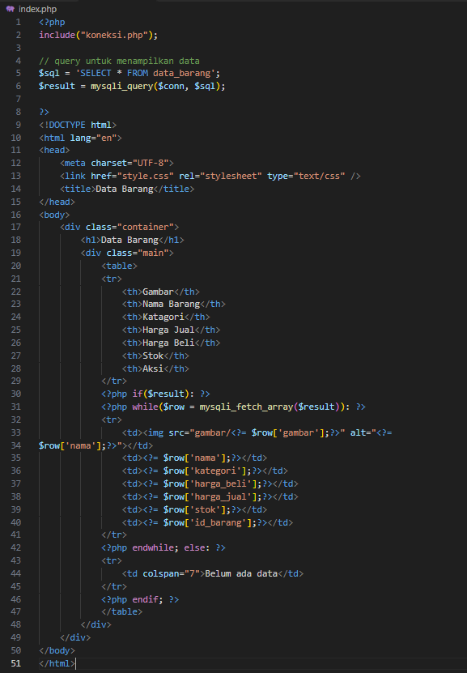
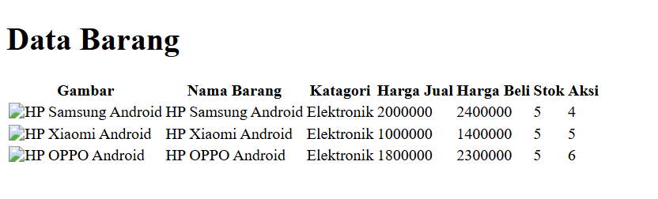
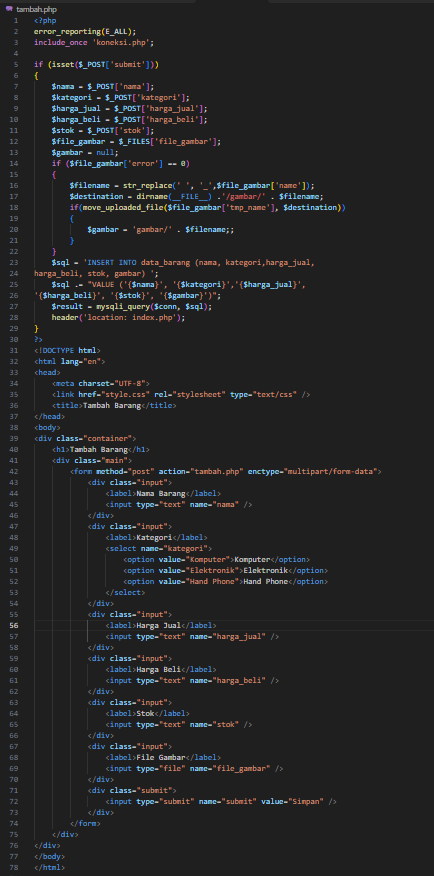
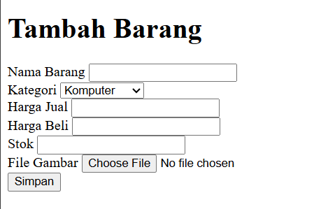
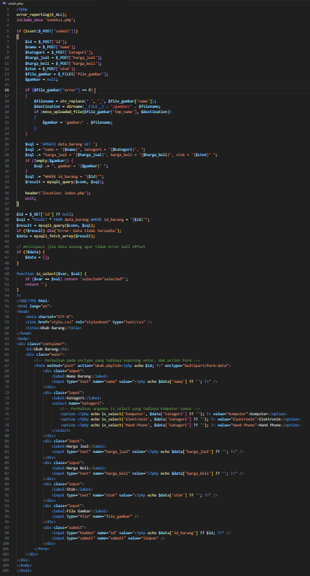
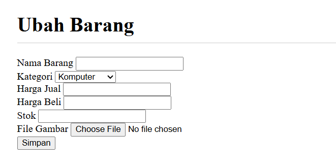
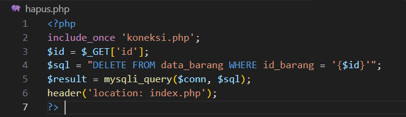

# Praktikum 8 – PHP dan Database MySQL

## Nama: Fadhil Syafiq Abdullah
## NIM: 312510161
## Kelas: I251B
## Mata Kuliah: Pemrograman Web

## 1. Membuat Database

Langkah pertama adalah membuat database melalui phpMyAdmin dengan nama `latihan1`. Database ini digunakan sebagai tempat penyimpanan seluruh data barang yang nantinya akan dikelola melalui aplikasi PHP. 

 

## 2. Membuat Tabel

Setelah database berhasil dibuat, langkah selanjutnya adalah membuat tabel bernama `data_barang`. Tabel ini berfungsi untuk menyimpan informasi barang dengan beberapa kolom, yaitu `id_barang`, `kategori`, `nama`, `gambar`, `harga_beli`, `harga_jual`, dan `stok`. Kolom `id_barang` menggunakan AUTO_INCREMENT sebagai identitas unik setiap barang. 

 

## 3. Mengisi Data Tabel

Selanjutnya, mengisi tabel `data_barang` menggunakan perintah SQL INSERT. Data yang dimasukkan berupa beberapa contoh barang elektronik, seperti HP Samsung, Xiaomi, dan OPPO, beserta kategori, harga beli, harga jual, dan jumlah stoknya. 

 

Output Isi Tabel: 

 

## 4. Membuat Folder Praktikum dan Mengakses localhost

Sebelum membuat program PHP, dibuat folder bernama `lab8_php_database` di dalam direktori `htdocs` XAMPP. Folder tersebut digunakan untuk menyimpan seluruh file aplikasi. Setelah itu, folder dapat diakses melalui browser menggunakan alamat `http://localhost/lab8_php_database/`. 

Pada tahap awal, halaman masih menampilkan tampilan default karena belum terdapat kode program PHP yang dibuat. 

 

## 5. Membuat Koneksi Database (koneksi.php)

Tahap berikutnya adalah membuat file `koneksi.php` yang berfungsi menghubungkan aplikasi PHP dengan database MySQL. Proses koneksi menggunakan fungsi `mysqli_connect()` dengan konfigurasi host, username, password, dan nama database. Apabila koneksi gagal, program akan menampilkan pesan kesalahan. 

 

Berikut merupakan hasil pengujian koneksi database untuk memastikan bahwa aplikasi PHP berhasil terhubung dengan MySQL. 

 

## 6. Menampilkan Data Barang (index.php)

Setelah koneksi database berhasil dibuat, selanjutnya membuat file `index.php` untuk menampilkan seluruh data barang yang tersimpan pada tabel `data_barang`. Proses pengambilan data menggunakan perintah SQL SELECT, kemudian hasilnya ditampilkan dalam bentuk tabel melalui HTML. 

 

Berikut merupakan tampilan halaman utama yang menampilkan data barang beserta informasi kategori, harga, stok, dan aksi pengelolaan data. 

 

## 7. Menambahkan Data Barang (tambah.php)

Selanjutnya membuat file `tambah.php` yang digunakan untuk menambahkan barang baru ke dalam database. Halaman ini menyediakan formulir input berupa nama barang, kategori, harga jual, harga beli, stok, dan file gambar. Setelah seluruh data diisi dan tombol Simpan ditekan, data akan diproses menggunakan perintah SQL INSERT dan disimpan ke dalam database. 

 

Berikut merupakan tampilan formulir yang digunakan untuk memasukkan data barang baru. 

 

## 8. Mengubah Data Barang (ubah.php)

Tahap selanjutnya adalah membuat file `ubah.php` untuk mengubah informasi barang yang sudah tersimpan di dalam database. Data barang diambil berdasarkan ID, kemudian ditampilkan kembali pada formulir agar pengguna dapat memperbarui informasi yang diperlukan. Setelah perubahan disimpan, program akan menjalankan perintah SQL UPDATE untuk memperbarui data. 

 

Berikut merupakan tampilan formulir untuk mengubah informasi barang yang telah dipilih. 

 

## 9. Menghapus Data Barang (hapus.php)

Langkah terakhir dalam proses CRUD adalah membuat file `hapus.php` yang berfungsi menghapus data barang berdasarkan ID barang. Proses penghapusan dilakukan menggunakan perintah SQL DELETE. Setelah data berhasil dihapus, halaman akan diarahkan kembali ke `index.php` untuk menampilkan data barang yang tersisa. 

